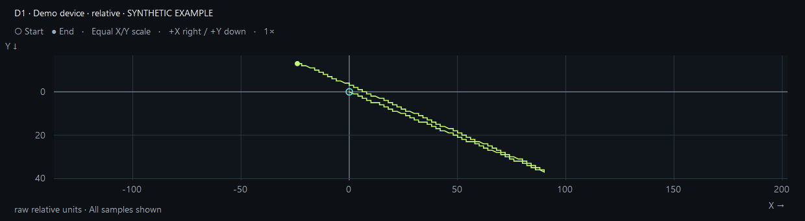
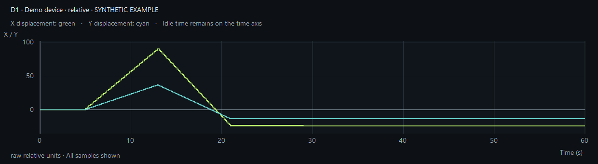
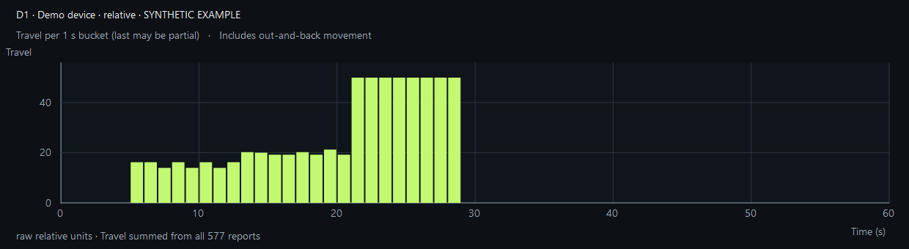

# Mouse Motion Inspector

[](https://github.com/Almo7aya/mouse-motion-inspector/actions/workflows/ci.yml)
[](https://github.com/Almo7aya/mouse-motion-inspector/releases/latest)
[](LICENSE)
[](#download-and-run)
[](https://dotnet.microsoft.com/en-us/download/dotnet/10.0)

**Investigate unexpected mouse movement, one device at a time.**

Mouse Motion Inspector is a free, open-source Windows utility for investigating
pointer drift and jitter. See which Windows mouse interface reports movement,
record hands-off tests, and compare surfaces, DPI settings and connections.
Your recordings stay on your computer. No account or cloud service is needed.

[Download for Windows](https://github.com/Almo7aya/mouse-motion-inspector/releases/latest) ·
[Quick start](#your-first-test) ·
[Read the graphs](#reading-the-graphs) ·
[Report a bug](https://github.com/Almo7aya/mouse-motion-inspector/issues/new?template=bug_report.yml) ·
[Contribute](CONTRIBUTING.md)

## Download and run

1. Open the [latest release](https://github.com/Almo7aya/mouse-motion-inspector/releases/latest).
2. Under **Assets**, download the ZIP ending in **`win-x64-self-contained.zip`**.
   This is the recommended package and includes the .NET runtime.
3. Extract the **entire ZIP** to a folder, then open **`MouseMotionInspector.exe`**.
   Keep the extracted files together and run the app as a normal user.

**No build script, SDK or terminal is needed to use the self-contained download.**

| Download | Who it is for | Requirements |
| --- | --- | --- |
| **Self-contained ZIP — recommended** | Anyone who wants to run the app | Windows x64; .NET is included |
| Framework-dependent ZIP | Users who already have .NET installed and want a smaller download | Windows x64 and the [.NET 10 Windows Desktop Runtime](https://dotnet.microsoft.com/en-us/download/dotnet/10.0) |
| Source ZIP / GitHub source archives | Contributors and users who want to build the app themselves | Windows x64 and the .NET 10 SDK; see [Contributing](CONTRIBUTING.md#build-and-test) |

Release packages are currently unsigned. For release-specific details, see the
notes alongside each download.

## What you can do

| Feature | Use it to… |
| --- | --- |
| **Device attribution** | Identify the Windows input interface reporting movement, including interfaces with identical names, and save recognizable labels. |
| **Repeatable tests** | Record with a settling countdown and label each run with its surface, DPI, polling rate and connection. Presets support custom values. |
| **Three graph views** | Explore movement paths, X/Y displacement and activity over time, with path zoom/pan, crosshairs and PNG exports. |
| **Separate input evidence** | Inspect Raw Input, Windows-flagged injected events and sampled cursor changes separately. |
| **Local recordings** | Save and reopen JSON recordings, export CSV summaries, and compare test conditions. |
| **Built-in guidance** | Follow the visual Identify → Record → Read → Compare guide and open help for a specific result. |

The app uses Windows Raw Input and is not limited to Razer mice. A reported
interface can belong to a mouse, keyboard, receiver, touchpad or virtual device;
identify it by moving one physical device at a time.

## Your first test

1. **Identify the device.** Move one mouse or pointing device. Watch **Live reports**
   to find its row, select it, and save a label in **Device identity**.
2. **Check capture.** Make a short timed test with deliberate movement first.
   Select the row with **Test reports** to see its trace.
3. **Record hands-off.** Enter the surface and your actual DPI/polling settings.
   Set **60 seconds** of recording with **5 seconds** to settle. Start the test,
   then release the mouse and leave the desk untouched before recording begins.
4. **Inspect the result.** Compare total travel, net displacement and the graphs.
   Check for warnings or a partial recording before drawing conclusions.
5. **Change one thing.** Repeat each condition 2–3 times, then try a different
   surface, DPI setting or connection. Keep deliberate-movement tests separate.

DPI and polling-rate fields are **labels for your test conditions**. The app does
not read, measure or change those device settings.

| Control | Action |
| --- | --- |
| **Ctrl+Shift+F8** | Start or stop a test globally |
| **Esc** | Stop while the app is focused |
| **Mouse wheel / drag** | Zoom / pan the movement path |
| **Double-click / Home** | Fit the movement path to the view |
| **Number-pad + / −** | Zoom the movement path |

## Reading the graphs

**Movement path** shows where the selected interface's recorded movement went,
relative to the start. Both axes use the same scale. The cyan circle marks the
start; the green dot marks the end.



*Chart previews on this page use synthetic example data.*

| View or metric | What to look for |
| --- | --- |
| **Movement path** | The direction and shape of the trace |
| **Displacement over time** | When X and Y change, reverse direction or stay still |
| **Activity over time** | Bursts of movement and quiet periods |
| **Total travel** | All movement added together, including movement back toward the start |
| **Net displacement** | How far the final position is from the starting point |

A mouse can move back and forth and finish at its starting point: **zero net
movement does not mean zero movement**. Compare travel with the path and timing.

<details>
<summary>Preview the displacement and activity graphs</summary>

### Displacement over time



### Activity over time



</details>

For a guided walkthrough, use **Interpretation guide** inside the app. The
[full interpretation guide](docs/interpretation.md) explains units, partial runs,
common patterns and what to try next.

## What the results can tell you

Raw Input can identify the **Windows interface that reported movement**. It does
not prove that a sensor is faulty or identify the process behind every cursor
change. Multiple interfaces can belong to one physical device.

Injected-event flags and cursor samples provide additional evidence, with their
own limits. A cursor change without an attributed report can remain unresolved.
Movement counts are not USB polling-rate measurements, and raw units are not
screen pixels or millimetres. See [measurement details](docs/interpretation.md#keep-the-evidence-streams-separate).

## Recordings and privacy

Recordings are saved automatically to:

```text
%LOCALAPPDATA%\MouseMotionInspector\recordings
```

Use **Open recordings** to reopen saved JSON tests, including compatible older
recordings and combined exports. CSV files contain summaries; use JSON when you
need to inspect a trace again. PNG exports capture the graph.

The app makes no automatic network requests, records no keystrokes, and does
not install drivers or change mouse settings. Project links open in your browser
when clicked. Exports can contain device identifiers, interface paths, screen
coordinates, mouse-button flags and personal notes. Review them before sharing.
Read the [security and privacy policy](SECURITY.md) for details.

## Frequently asked questions

### Do I need to run `build-native.ps1`?

**No, if you downloaded a release.** The script is for building the Windows app
from source: it compiles the code, runs native checks and creates runnable output
in `artifacts/MouseMotionInspector/`. Contributors can follow the
[build instructions](CONTRIBUTING.md#build-and-test). Everyone else can use the
self-contained ZIP above.

### Why is the graph empty while live counters are changing?

Live identification updates counters; plotting starts with a timed test. Record
a short deliberate-movement test, then select a row with **Test reports**. An
explicitly selected quiet interface stays selected even when another one moves.
See [identify before recording](docs/interpretation.md#identify-before-recording).

### Why does one mouse appear more than once?

Windows can expose multiple input interfaces for one device, with the same name.
Move one physical device at a time and label the row that changes. A duplicate
name does not establish that there are two separate mice.

### Can I use it in a browser?

The release includes a standalone **`index.html`** cursor tester. Open it in a
desktop browser for basic movement recording. Browsers cannot attribute that
movement to a physical device, and the browser tester uses its own units and
recording format. See the [browser guide](docs/browser-guide.md).

## Help and contributions

[Report a bug](https://github.com/Almo7aya/mouse-motion-inspector/issues/new?template=bug_report.yml)
or [suggest a feature](https://github.com/Almo7aya/mouse-motion-inspector/issues/new?template=feature_request.yml).
For bug reports, include the app and Windows versions, steps to reproduce, expected
and actual behavior, and relevant test conditions. Share screenshots or reviewed
recordings when they help explain the issue.

Code, documentation, reproducible bug reports and usability feedback are welcome.
Read [Contributing](CONTRIBUTING.md) for setup, build commands, checks and pull
request guidance. Report security issues through the [private reporting channel](SECURITY.md).

Both [build CI](https://github.com/Almo7aya/mouse-motion-inspector/actions/workflows/ci.yml)
and [release publishing](https://github.com/Almo7aya/mouse-motion-inspector/actions/workflows/release.yml)
are **manual-only**. Pushes and pull requests do not trigger them.

## Documentation

- [Interpretation guide](docs/interpretation.md) — understand measurements and troubleshoot results.
- [Browser guide](docs/browser-guide.md) — use the standalone cursor tester.
- [Architecture](docs/architecture.md) — capture, storage, rendering and diagnostic commands.
- [Release checklist](docs/release-checklist.md) — automated and manual validation.
- [Publishing](docs/publishing.md) — maintainers' release workflow.

## License

[MIT](LICENSE). Created by Almo7aya and contributors.

Independent project; not affiliated with Razer or any device manufacturer.
